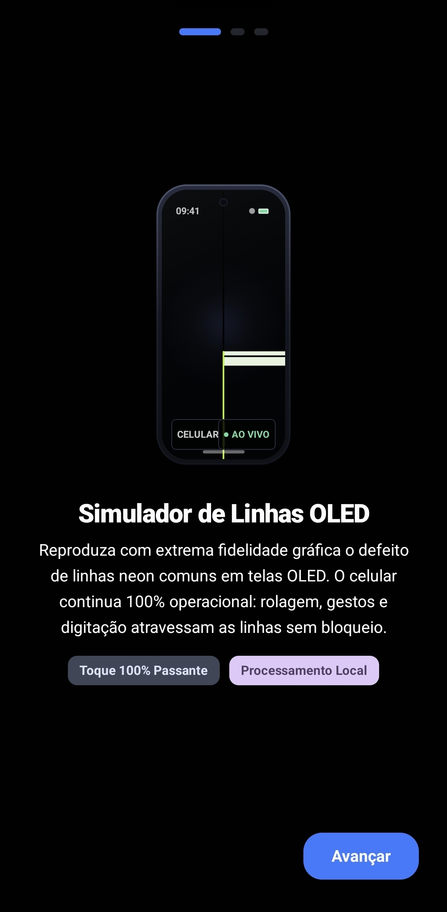
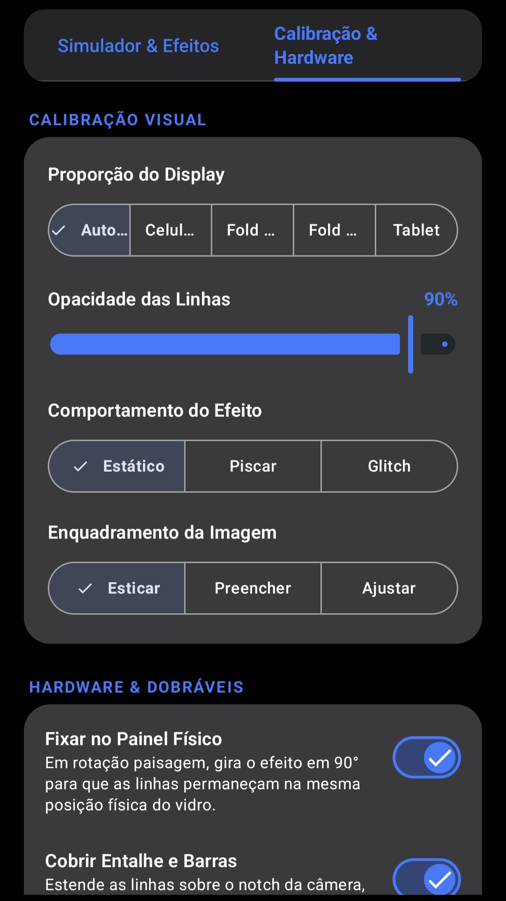

# AhhDuo

### Simulador Interativo do Glitch de Linha do iPhone Duo

**O famoso defeito visual da linha na tela, recriado em uma experiência interativa.**

O **AhhDuo** é um simulador interativo que reproduz o famoso efeito visual de linha na tela do iPhone Duo, recriando sua aparência característica diretamente em um aplicativo Android.

Desenvolvido para entretenimento, demonstrações e experiências visuais, o AhhDuo transforma esse fenômeno viral em uma simulação interativa.

**Nenhum dano físico é causado ao dispositivo.** Todos os efeitos são reproduzidos exclusivamente por software.

---

## ✦ SOBRE O PROJETO

O AhhDuo transforma o conhecido glitch de linha na tela do iPhone Duo em uma experiência interativa.

O aplicativo reproduz as características visuais desse fenômeno, permitindo que os usuários experimentem sua aparência diretamente em seus dispositivos Android.

O projeto combina simulação visual com uma interface moderna, inspirada no **Google Material 3 Expressive**.

---

## ✦ FUNCIONALIDADES

- **Simulação interativa:** reproduz o conhecido glitch de linha na tela.
- **Reprodução visual:** recria a aparência característica do problema de display do iPhone Duo.
- **Experiência imersiva:** simulação em tela cheia.
- **Interface moderna:** identidade visual inspirada no Material 3 Expressive.
- **Entretenimento:** desenvolvido para demonstrações e brincadeiras.

---

## ✦ INTERFACE E DESIGN

O AhhDuo segue os princípios visuais do **Google Material 3 Expressive**, priorizando:

- Componentes e layouts expressivos.
- Tipografia consistente.
- Hierarquia visual bem definida.
- Transições e animações fluidas.
- Cores cuidadosamente selecionadas.
- Navegação intuitiva.

---

## ✦ CAPTURAS DE TELA

Confira abaixo algumas telas reais do AhhDuo.

### Tela inicial

  

### Simulação

  

### Configurações

  

---

## ✦ DOWNLOAD

As versões oficiais do AhhDuo serão disponibilizadas na seção de lançamentos deste repositório.

**[BAIXAR AHHDUO](../../releases)**

### Como instalar

1. Acesse a página de [Releases](../../releases).
2. Selecione a versão mais recente.
3. Baixe o arquivo APK.
4. Abra o arquivo no dispositivo Android.
5. Siga as instruções para concluir a instalação.

---

## ✦ COMPATIBILIDADE

| Especificação | Detalhes |
|:---|:---|
| Plataforma | Android |
| Distribuição | APK |

---

## ✦ ESTADO DO PROJETO

**Em desenvolvimento.**

O AhhDuo poderá receber melhorias, refinamentos visuais e novas funcionalidades ao longo de seu desenvolvimento.

Acompanhe este repositório para conferir as próximas atualizações.

---

## ✦ PROBLEMAS E SUGESTÕES

Encontrou algum problema ou deseja sugerir uma melhoria?

Utilize a seção de [Issues](../../issues) para relatar erros, compartilhar sugestões ou enviar feedback.

Ao reportar um problema, informe:

- Modelo do dispositivo.
- Versão do Android.
- Versão do AhhDuo.
- Descrição do problema.
- Capturas de tela, se possível.

---

## ✦ AVISO LEGAL

O **AhhDuo é um projeto independente de entretenimento**, sem vínculo, afiliação ou endosso oficial da Apple.

O aplicativo reproduz um efeito visual por meio de software e não causa danos físicos ao dispositivo.

As marcas e os nomes mencionados pertencem aos seus respectivos titulares.

---

# AhhDuo
**by Imgu.**

